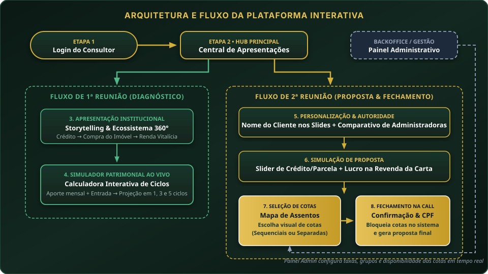

# Proposta & Escopo do Projeto: Plataforma de Apresentação Interativa e Reserva de Cotas

## 1. Visão Geral do Projeto
Desenvolvimento de uma **Plataforma Web Interativa de Vendas de Consórcio e Alavancagem Patrimonial**, projetada especificamente para ser utilizada pelos consultores/closers durante reuniões por videochamada (1ª e 2ª reunião).

O objetivo do sistema é substituir apresentações estáticas (PDF/PowerPoint) por uma **experiência visual interativa de alta conversão**, que educa o cliente, calcula cenários financeiros ao vivo e conduz o fechamento com **reserva visual de cotas ("mapa de assentos")** ainda dentro da chamada.

---

## 2. Módulos e Funcionalidades Inclusas

### Módulo 1 — Acesso da Equipe e Central de Apresentações
- **Login individual para consultores/vendedores.**
- **Central de Apresentações** dividida por etapa comercial:
  - **Roteiro de Reunião:** Guia rápido de perguntas de qualificação e contorno de objeções.
  - **Apresentação de 1ª Reunião:** Foco em diagnóstico, autoridade da empresa e construção de patrimônio.
  - **Apresentação de 2ª Reunião (Fechamento):** Foco em comparação de cenários, escolha do grupo, simulação de crédito e reserva de cotas.

### Módulo 2 — Apresentação Interativa de 1ª Reunião (Diagnóstico & Ciclos)
- **Ecossistema da Empresa (Linha do Tempo Interativa):**
  - Navegação visual pelas etapas da consultoria: *Obtenção do Crédito → Aquisição do Imóvel → Gestão e Renda Passiva*.
  - Exibição de cases reais de autoquitação imobiliária.
- **Calculadora de Ciclos de Alavancagem Patrimonial:**
  - O consultor preenche ao vivo com o cliente:
    - *Valor disponível para investir por mês (R$)*
    - *Valor de entrada/lance inicial (R$)*
    - *Quantidade de ciclos (1, 3 ou 5 ciclos)*
  - O sistema calcula e exibe na hora o **patrimônio acumulado projetado**, a **renda passiva mensal estimada** e uma **tabela detalhada ciclo a ciclo** demonstrando como o aluguel do bem contemplado paga as parcelas seguintes.

### Módulo 3 — Apresentação Interativa de 2ª Reunião (Proposta & Produto)
- **Personalização Dinâmica com o Nome do Cliente:**
  - Antes de iniciar os slides, o consultor digita o nome do cliente e toda a apresentação passa a exibir chamadas personalizadas (ex.: *"[Nome do Cliente], seus 5 passos para o sucesso"*).
- **Critérios de Seleção e Comparativo de Administradoras:**
  - Apresentação dos 3 pilares de escolha (*Administradora, Índice de Contemplação e Perfil do Grupo*).
  - Tabela comparativa visual entre administradoras tradicionais do mercado vs. o grupo/estratégia recomendada (comparando número de participantes e média de contemplações mensais).
- **Explicação Visual das Modalidades de Contemplação:**
  - Telas interativas demonstrando as probabilidades de contemplação: *Sorteio, Lance Fixo, Lance Fidelidade / Acelerador e Lance Livre / Embutido*, além dos diferenciais do grupo.

### Módulo 4 — Simuladores de Fechamento ao Vivo
- **Simulador de Valorização / Revenda de Carta Contemplada:**
  - Demonstração visual do retorno financeiro caso o cliente seja contemplado em **6, 12, 18 ou 24 meses**, exibindo *Valor Pago vs. Valor de Mercado da Carta Contemplada vs. Lucro Líquido e ROI*.
- **Simulador de Crédito com Slider Interativo:**
  - Barra deslizante (slider) onde o consultor ajusta o valor do crédito desejado (ex.: de `R$ 300 mil` a `R$ 1 milhão+`).
  - Atualização instantânea do **valor da parcela (cheia ou reduzida)** e da **quantidade de cotas** necessárias para compor a estratégia.

### Módulo 5 — Mapa Visual de Cotas ("Escolha o Assento da Sua Cota")
- **Interface visual estilo mapa de assentos:**
  - Exibe todas as cotas do grupo divididas por cores:
    - 🟢 **Disponível para seleção**
    - 🟡 **Selecionada pelo cliente na chamada**
    - ⚫ **Ocupada / Indisponível**
  - Permite selecionar a estratégia ao vivo com o cliente: **cotas sequenciais/vizinhas** (para contemplação por aproximação) ou **cotas separadas**.
- **Captura Final e Reserva da Proposta:**
  - Preenchimento de **Nome Completo + CPF** do cliente no último passo.
  - Ao confirmar, o sistema **bloqueia/reserva automaticamente as cotas selecionadas** no banco de dados e gera o registro da proposta para emissão do contrato.

### Módulo 6 — Painel Administrativo (Gestão dos Grupos e Cotas)
- Cadastro e edição de grupos, taxas, valores de parcelas e parâmetros das calculadoras.
- **3 Modos de Controle do Mapa de Cotas** (sem depender de integração com sistema de administradora):
  1. **Controle Interno:** O sistema gerencia 100% das vagas disponíveis, reservadas (com bloqueio temporário de 24h/48h após a call) e vendidas.
  2. **Espelhamento Rápido:** O administrador cola a lista ou faixa de cotas disponíveis no dia e o sistema marca as demais como ocupadas automaticamente.
  3. **Ocupação Inteligente:** O administrador define a porcentagem de ocupação visual do grupo (ex.: 70% preenchido) para gerar escassez na apresentação e registrar a preferência de posicionamento do cliente.
- Listagem de todas as propostas geradas pelos vendedores (com Nome, CPF, valor simulado, cotas escolhidas e consultor responsável).

---

## 3. Tecnologias Utilizadas
- **Frontend:** Aplicação Web moderna em React / Next.js com Tailwind CSS e animações fluidas (responsiva para telas Full HD, notebooks e projetores).
- **Backend & Banco de Dados:** PostgreSQL / Supabase (autenticação segura de consultores e atualização em tempo real do mapa de cotas).
- **Hospedagem:** Nuvem de alta velocidade (Vercel + Supabase), com custo de servidor praticamente zero no início da operação.

---

## 4. Cronograma de Entrega Estimado
1. **Fase 1 (Semana 1–2):** Estrutura visual, login, Central de Apresentações e Fluxo da 1ª Reunião + Calculadora de Ciclos.
2. **Fase 2 (Semana 3–4):** Fluxo da 2ª Reunião, personalização por cliente, comparativos e Simuladores de Crédito/Carta Contemplada.
3. **Fase 3 (Semana 5–6):** Mapa interativo de assentos/cotas, confirmação de dados (CPF), Painel Administrativo e testes finais.

---

## 5. Investimento 

- **Valor de referência de mercado para desenvolvimento sob medida deste escopo:** ~~`R$ 22.000,00`~~
- **Condição especial de parceria/amizade (custo simbólico de desenvolvimento):** **`R$ 3.200,00`** *(ou parcelado / dividido por entregas)*

